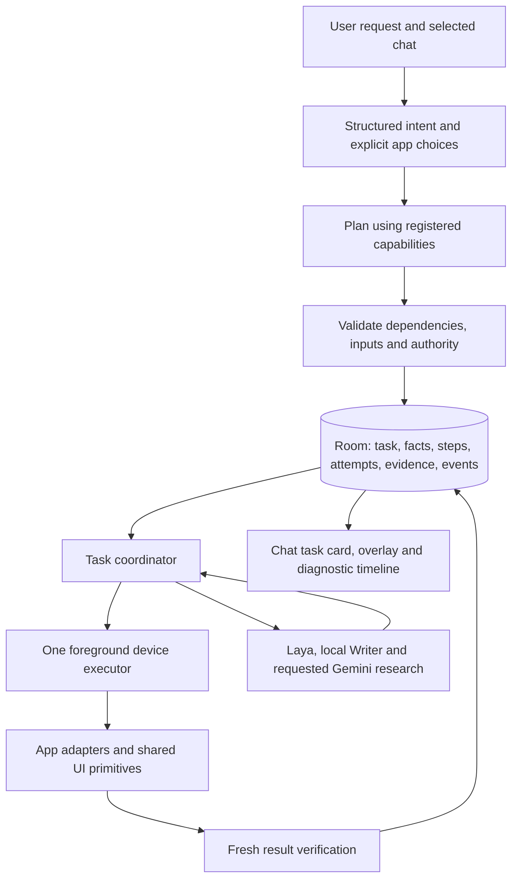

# Friday coordinator implementation plan

_2026-10-20 · implementation plan and M1 evidence · local Android runtime_

## 1. Objective and current status

Build one coordinator that understands a goal, saves a plan in the selected chat, executes supported capabilities, verifies their outcomes and recovers from interruptions. A new combination of supported actions should reuse the same engine. Places, dates, recipients, wording and app preferences are task inputs.

**Interpretation/execution migration:** all new entries now create version-two capability graphs, including Research, read → summary and draft → composer. Hotel inputs use explicit owner facts; the retired prototype cannot intercept new requests. Contextual item/section resolution is source-bound and experimental; real local-model semantic failures remain open. See the [migration coverage](FEATURE_TEST_COVERAGE.md#interpretation-and-shared-execution-checkpoint). An intermediate Pixel build passed 42 synthetic checks; the expanded 45-case suite and final installation are pending after disconnection.

**Earlier shared capability checkpoint:** Research and device plans now use one persistent execution loop. Registered device capabilities cover calendar creation, bill reading, app opening/search, standalone text drafting and publication. Dependencies, typed output bindings, exact verifiers, evidence freshness and interrupted-write reconciliation are implemented. The installed Pixel build passes **35/35 synthetic coordinator checks** and **19 component groups**. This does not establish a general model planner or complete migration of legacy workflows. See the [checkpoint](../research/41-capability-checkpoint.md) and [independent evaluation harness](NAVIGATION_HARNESS.md). The earlier Research acceptance record below remains valid within its stated scope.

**Earlier M1 Research checkpoint: implemented and installed on the Pixel**, with Room persistence, saved steps, Stop/Resume and idempotent publication. The final build passes **24/24 synthetic coordinator checks**, focused fixtures and the 18-group component selfcheck. Live evidence includes fresh-session capture, label isolation, short answers, UI Stop, assisted restart Resume, repeated recheck and clipboard freshness. **M1 has not passed:** automatic conversation location, clean fresh restart acceptance and content constraints remain open.

Current evidence:

| Observation | Actual result |
| --- | --- |
| Nepal research → hotel attempt | 54.995 seconds; Gemini's complete 2,387-character answer was captured, then destination entry failed. |
| Separate hotel continuation | 23.176 seconds; correct Kathmandu/date/occupancy fields were verified and results loaded, but automatic results-header verification failed. A later manual scroll is diagnostic evidence only. |
| Andaman request mentioning Gemini | 165 milliseconds; incorrectly opened Chrome with the entire instruction as Google keywords. Research and stay search did not run. |
| Andaman follow-up | 142 milliseconds; the same wrong provider and instruction-as-query failure. |
| Writer | Earlier refinement passed 19/20 mechanical checks with semantic errors. Latest 20-case Pixel run: seven expected invalid rejections passed; 13 memory-unavailable outcomes, zero accepted outputs/native generation. |
| Earlier Pixel synthetic checks | **22/22 fake coordinator checks and focused selectors passed.** They did not validate whole-response capture through Gemini's live Copy controls. |
| Live Mongolia research/stay request | Recorded completion was false: only the final 2,889 characters were saved although earlier observed answer blocks already exceeded 4,000 characters. No stay app was searched. |
| Latest build checks | Installed on Pixel; **24/24 fake coordinator checks** and all four focused fixture groups pass. API 35 emulator synthetic coverage also passes. |
| Assisted Mongolia correction | Whole-response Copy retained 8,794 characters across 10 observed response TextViews, replacing the partial answer in one original-chat row with unchanged Submit attempts. Capture took 5.642 s and publication 0.033 s after manual setup. |
| Recovery and recheck | L15 initially failed Copy after restart; an installed IME fix enabled same-task Resume in 8.372 s, retaining one row with no new dispatch. Two L16 rechecks passed at 7.986 s / 8.011 s. This was an assisted failure-to-fix sequence. |
| Final clipboard-freshness recheck | Live full 1,587-character recapture passed with one row and no new dispatch; event span 7.296 s, capture increment 6.544 s. |
| Maps / Gmail | Maps passed in 2.638 s and repeated in 3.424 s. After URI repair, Friday returned unverified after 4.868 s; subsequent operator inspection confirmed the exact recipient/subject/body without edits. Field-population time is unmeasured. No app accessibility root was available; automatic readback remains unverified. Nothing was sent. |
| M1 acceptance | Automatic conversation location and clean restart acceptance remain open. L02 exceeded its word limit and L05 missed numbering. No stay app/search ran. |

See [measured diagnostics](../research/36-nepal-live-flow-and-timing.md) and [primary research](../research/35-task-coordinator-research.md). There is no verified successful fresh Nepal end-to-end time yet.

## 2. Architecture and boundaries



| Component | Owns | Must not own |
| --- | --- | --- |
| Intent parser | Requested outcomes, ordering, explicit facts, app preferences, missing information | Device actions or completion claims |
| Planner | Small dependency graph composed from registered capabilities | Arbitrary code, new permissions or invented capabilities |
| Coordinator | Scheduling, provider binding through the resolver, persistent progress, revisions, deadlines, cancellation, verification and recovery | Country-specific workflows or screen coordinates |
| App adapter | Supported operations, selectors, allowed app hosts and readback | Provider substitution, user intent or promotion of research suggestions into confirmed choices |
| Laya | Grounded UI action/target selection within the active step | Text generation, global task management or final completion authority |
| Writer | Bounded query composition, drafts, summaries and evaluated extraction | Unvalidated general planning or factual authority |
| Gemini | Requested external research through its normal app chat | Executable instructions or authorization for downstream actions |
| UI | Plan, current step, progress, missing inputs and verified outcomes | A second copy of task state |

Use native Kotlin and local Room/SQLite. Room provides persistence and schema migration support; it does not control other apps or guarantee that a tap happened. The M1 build integrates Room/KSP with the current AGP 9.4.1 build. [Android Room documentation](https://developer.android.com/training/data-storage/room).

Supabase, a server workflow engine and additional agent frameworks are deferred. Existing app-private chat transcripts remain readable during migration. Android recommends a local source of truth for offline state and observable data for UI updates. [Android data-layer guidance](https://developer.android.com/topic/architecture/data-layer).

### What scales and what stays app-specific

- A different destination or paraphrase changes task data and fixtures.
- A new composition of existing capabilities changes the plan.
- A different app requires an adapter with supported operations and verifiers.
- A genuinely new action requires a capability contract and acceptance tests.
- Resource IDs, normal-chat controls and calendar behavior belong in adapters.
- Country/city lists, sample dates and exact example sentences do not belong in coordinator routing.
- Unsupported requests produce an explicit capability gap. They do not silently fall back to Chrome.

## 3. Small persistent contract

| Record | Essential fields |
| --- | --- |
| Task | `task_id`, captured `chat_id`, original request, structured goal, revision, state, cancellation epoch, final criterion |
| Fact | Typed value or unknown, supplied/observed/derived/proposed status, source evidence, capture time and sensitivity |
| Step | `step_id`, capability/version, dependencies, provider binding, input fact references, registered verifier, state and bounded retry/deadline policy |
| Attempt | Task revision/epoch, intended action, before observation, dispatch state, after observation, verifier outcome and timings |
| Evidence | Source package, observation time, coverage, content hash and bounded app-private content/reference |
| Event | Ordered task/step transition or action event, reason, timestamp and measured duration |

Do not implement a separate approval table initially: bind approval to the exact step payload hash, revision and cancellation epoch. Do not store executable predicates; verifiers are registered code selected by identifier.

Dates retain local date, year and interpretation timezone. Zero children is a value; unknown children is missing input. Research recommendations remain proposals until the user chooses them. A request for a good season does not supply a stay duration or guest count.

Each capability declares typed inputs/outputs, required facts, app support, side effects, timeout, cancellation, reconciliation and a completion verifier. A result is structured: verified output, missing input, external wait, failed operation, cancelled operation or uncertain outcome. A success sentence is presentation derived from that result.

### Task and step states

```text
QUEUED → PLANNING → READY → RUNNING → VERIFYING → COMPLETED
                        ↘ WAITING_INPUT
                        ↘ WAITING_APPROVAL
                        ↘ WAITING_EXTERNAL
                        ↘ OUTCOME_UNKNOWN → RECONCILING
                        ↘ FAILED / UNSUPPORTED / CANCELLED
```

The coordinator runs an eligible authorized prefix while dependent inputs remain unknown. For example, research can proceed before exact hotel dates are selected. Normal app loading and Gemini generation are external waits with progress, rather than repeated requests to say “continue.”

### Core invariants

1. Persist the validated plan before the first external action.
2. Persist an attempt's intent before dispatch; verify fresh evidence before completing it.
3. An app launch, accepted accessibility click or model `DONE` cannot complete its parent goal.
4. Explicit app choice wins over defaults and keyword routes.
5. One executor owns foreground mutations across all chats. Reasoning over captured data can run independently.
6. A revision or cancellation change invalidates late model results and dependent outputs.
7. Reconcile an interrupted action before retrying; internal attempt IDs cannot deduplicate a third-party UI action.
8. Facts, results, questions and approvals remain attached to their originating task/chat.
9. Research and app content are data. They cannot add actions, change recipients or authorize a send.
10. Private-source summaries retain their source sensitivity; they do not automatically enter a Gemini prompt.

## 4. Execution and recovery

For each step:

1. Resolve its input facts, provider and current revision.
2. Check dependencies, authority and the current app state.
3. Save the attempt intent and acquire device ownership.
4. Reobserve immediately before a mutation; reject stale or wrong-app targets.
5. Dispatch the bounded operation.
6. Read fresh evidence and run the step's verifier.
7. Save its output or the precise waiting/failed/unknown reason, then select the next eligible step.

A process can die between a tap and the checkpoint afterward. On restart, dispatched unfinished attempts enter reconciliation, not automatic replay. For Gemini, inspect the saved conversation/question before sending again. For messaging, inspect the destination and payload before repeating any consequential action. Unresolvable uncertainty remains visible as `OUTCOME_UNKNOWN`.

Preserve the current `AgentService` request gate initially. Its native model lock has thread-ownership assertions: do not move a locked native engine between coroutine threads. Keep model calls on their owning worker until a dedicated model dispatcher is implemented and measured. A coroutine mutex is synchronization, not durable state. [Kotlin Mutex contract](https://kotlinlang.org/api/kotlinx.coroutines/kotlinx-coroutines-core/kotlinx.coroutines.sync/-mutex/).

Room preserves progress; continuous control still depends on an available service, accessible/unlocked app state and Android lifecycle rules. WorkManager can schedule supported persistent background work, but it is not the foreground UI executor or a way around activity-start restrictions. [Android persistent work](https://developer.android.com/develop/background-work/background-tasks/persistent), [background activity restrictions](https://developer.android.com/guide/components/activities/secure-bal).

## 5. Implementation order and gates

### M0 — Freeze contracts and baseline

- Adopt this plan and record the installed-versus-source baseline.
- Turn recorded failures into fixture specifications with independent verifiers.
- Keep the existing Nepal prototype available for comparison; freeze additions of destination-specific orchestration.
- Keep current Research-button preparation separate from a claim of durable coordination.

**Gate:** each baseline records its actual outcome, intervention count and timing. A pending task or opened app is not an end-to-end pass.

### M1 — Durable Research as the first complete slice

The implemented coordinator package contains typed records, Room schema/DAOs, a capability registry, a fixed Research plan, plan validation and task execution. It retains the current request gate and transcript format. Research entry builds its declared graph; this slice does not claim a general generative planner.

Research entry produces this plan before opening an app:

```text
prepare normal Gemini session
→ submit the exact question
→ wait for and capture the complete matching answer
→ publish it to the originating Friday chat
```

The generic `GeminiResearch` adapter runs at those persisted boundaries. The coordinator saves the exact question/prompt, unique completion marker, conversation evidence and submission state before Send. Resume reconciles the saved question and marker with Gemini before continuing; it does not create a new chat and resend an uncertain submission blindly.

Publish results idempotently: save the final answer/evidence and a publication key `(task_id, result_revision)` in Room, then project it into the existing transcript. Check that key before append during recovery. Completion and a JSON transcript append are separate writes; a crash must not lose the visible answer or duplicate it. Publication status can live on the step/event record without another table.

Drive the overlay and chat task card from persisted events: current step, completed steps, elapsed time, waiting reason, Stop and recoverable Resume.

#### Implemented behavior and observed evidence

The local app-private database is `friday_tasks.db`, with task, step, attempt, fact, evidence and event records. A normal new Research task automatically waits for its matching complete response within the bounded response deadline; the owner does not need to keep requesting continuation while generation proceeds. Interrupted or uncertain tasks are recoverable through the task card's **Resume** action after external-state reconciliation. Startup recovery does not force a different selected chat or blindly repeat app actions.

The installed capture path requires Gemini's whole-response **Copy for every answer**, the saved marker and observed-block coverage. A final semantic block and footer alone are insufficient. Whole Copy now has assisted correction, standalone/fresh-session capture, seven-character-answer and repeated-recheck evidence. This does not establish compliance with every requested word/format constraint or automatic conversation recovery.

Stop and chat clearing invalidate workers so late capture/publication cannot advance a cancelled or deleted task. Overlay Stop and task-card Stop both invalidate execution. Clearing also acquires the shared request gate before cancelling and purging the chat. Results retain their original chat ID and publication key. Rechecking preserves the exact question and verified Send, resets capture/publication, and atomically replaces the matching old transcript row only when its chat/task identity, publication key and answer hash still match. Replaying that correction leaves one visible turn.

An earlier Pixel build passed **22/22 synthetic coordinator checks**, with focused selectors also passing. Those included the saved-submission receipt for an offscreen question and U+200B footer handling. They did not establish complete live capture: the later false result had fresh exact-user-turn correlation, yet was still only a trailing answer fragment.

The latest isolated **API 35 emulator passed 24/24 synthetic coordinator checks**, plus Copy selector/coverage fixtures. Coverage includes plan validation, Room rollback, uncertain-send reconciliation, partial/evidence rejection, cancelled/deleted/stale workers, originating-chat publication/replay, scoped clearing and result-recheck replacement. These use actual Room and a fake `ResearchDriver`; they are not Gemini operations or an end-to-end success rate. The focused `research_selfcheck` includes a `gemini_copy` result from `GeminiResponse.selfCheck()`, alongside chat, research and hotel fixtures, without native model inference.

The final build is installed on the Pixel, where **24/24 synthetic coordinator checks**, `gemini_chat`, `gemini_research`, `gemini_copy` and `hotel` fixtures, and the full **18-group component selfcheck** pass. The latter includes mailto encoding and clipboard freshness boundaries. Copy rejection diagnostics retain lengths/footer status rather than raw copied excerpts. The broad legacy `selfcheck` crashes on the emulator with `SIGILL` in native WakeDetector/ONNX; that separate limitation is unchanged.

A separate emulator force-stop/relaunch preserved unfinished task state without replay. Pixel L14 then verified real UI Stop during generation: persisted cancellation in approximately 0.902 s, no late publication during a 3 s observation, and a working independent request. Composer/Run/Research/task controls remain accessible. These checks are distinct from the assisted Pixel restart sequence below.

The live Mongolia public group-trip research/stay attempt recorded the following timings before its **false completion**:

| Phase | Recorded active time |
| --- | ---: |
| Prepare | 6.960 s |
| Submit | 7.004 s |
| Capture, including waiting | 99.276 s |
| Publish | 0.294 s |
| Sum of recorded segments | **113.534 s** |
| `PLAN_SAVED` → `TASK_COMPLETED` event timestamps | **113.578 s** |

These are timings of a failed acceptance attempt, not successful end-to-end research. The final 2,889-character semantic block omitted earlier observed content exceeding 4,000 characters. No accommodation app/search ran. An earlier live question was cancelled after owner Stop; it is not evidence of successful resume after force-stop. See [the live diagnostic record](../research/36-nepal-live-flow-and-timing.md).

The subsequent correction retained **8,794 characters** with `provider_copy_response`, covering 10 observed response TextViews. It passed single-row, original-chat, answer-hash and removed-marker checks; the Submit attempt count stayed at one. This is a logical checkpoint, not a physical tap count: one attempt can include accessibility dispatch and guarded gesture fallback. Capture took 5.642 s and publication 0.033 s after manual reopening/slight scrolling of the original Gemini conversation. The earlier automatic locator attempt waited roughly 120 s on blank Gemini home and became `OUTCOME_UNKNOWN` after operator interruption. Correction is verified after assisted setup; autonomous recovery is not. See the [wider live report](../research/37-pixel-research-live-acceptance.md).

L15 separately force-stopped Friday after verified submission. Its initial 66.035 s resume ended `OUTCOME_UNKNOWN`; the interval included a failed service-restoration script and operator repair. After installing IME-aware Copy navigation, the **same-task retry passed in 8.372 s**, capturing 1,587 characters with unchanged prepare/submit attempts, no new dispatch and one original-chat row. The entire 263.613 s sequence includes diagnosis/build/install and is not clean autonomous recovery time. Two L16 rechecks passed at **7.986 s / 8.011 s**, preserving one row with no new dispatch. A further live recheck on the final clipboard-timestamp build passed with a **7.296 s** event span and **6.544 s** capture increment. Initial failures remain recorded; no automatic history locator is claimed.

#### Diagnostic bridge commands

Send newline-delimited JSON through the existing [debug bridge](app.md). These commands inspect or control local task state; a control acknowledgement alone is not a verified task outcome.

| Request | Meaning |
| --- | --- |
| `{"cmd":"coordinator_selfcheck"}` | Run the synthetic Room/fake-driver suite on the bridge worker; report individual checks and pass/fail counts. |
| `{"cmd":"research_selfcheck"}` | Run focused normal-chat, response/footer, whole-response Copy and hotel fixtures; Copy checks appear as `gemini_copy`. |
| `{"cmd":"task_state"}` | Inspect the latest task for the selected chat, including steps, events, timings and evidence. |
| `{"cmd":"task_state","task_id":"<task-id>"}` | Inspect a specific persisted task. |
| `{"cmd":"resume_task","task_id":"<task-id>"}` | Request reconciliation/resumption; `started` reports whether execution was accepted. |
| `{"cmd":"recheck_task","task_id":"<task-id>"}` | Recollect a previously published answer using its saved question/submission, then atomically replace its old chat turn if verification passes; no new Send. |
| `{"cmd":"cancel_task","task_id":"<task-id>"}` | Signal cancellation; inspect subsequent task state to confirm its terminal outcome. |

After forwarding the bridge, run `python3 scripts/coordinator_test.py` (or `--port <port>`) for the coordinator and focused selector suite. Reports go to ignored `captures/coordinator-tests/`.

Task snapshots can contain private questions, reasons and evidence. Keep raw bridge reports in ignored local captures rather than public fixtures.

**Gate:** arbitrary-subject research, normal new chat, restart after Send without duplicate submission, Stop during wait, separate-chat isolation, and truthful pending behavior for inaccessible/partial/oversized responses. No manual taps count toward a pass.

**Gate status: not passed.** Capture, tested isolation, Stop, assisted Resume/rechecks, final clipboard freshness and Maps have evidence. Gmail population is visually repaired, but automatic readback remains unavailable. The latest Writer run generated no outputs due to memory availability. Automatic conversation location, clean restart and content constraints remain open; L02 exceeded its word limit, L05 missed numbering and the exact L03 case was not rerun. Final clipboard/URI fixes are installed and their scoped retests are recorded.

### M2 — Shared text and message capabilities

Wrap the existing Writer, message read and draft handoff behind the same typed contract. Add `text.transform`, `messages.read` and `message.prepare`.

**Gate:** both read → summarize and generate → prepare draft use the same coordinator. Verify source coverage, meaning, recipient, subject and exact body separately. Final Send retains its existing authorization boundary.

### M3 — Research to accommodation search

Add structured fact extraction and clarification as downstream consumers of generic research. Wrap the existing hotel field/calendar/results adapter as `hotel.search`.

**Gate:** Nepal and Andaman use the same plan/capabilities, with only fixture facts changed. Missing dates, guests, child ages or material choices block dependent actions. Verify every supplied field before Search and verify the results header plus actual cards afterward. Booking/payment are separate steps, not implied by hotel-search completion.

### M4 — General natural-language planning

The Research button provides an explicit capability entry while general understanding improves. Extend the replaceable intent/parser and planner implementations; parse facts, provider preferences, ordering and requested outcomes into constrained schemas. Generate plans only from registered capabilities and validate them before dispatch.

Evaluate the local SLM on held-out intent, query, reference-resolution and plan cases. Valid JSON is insufficient. Preserve deterministic handling of clear commands; ambiguous multi-intent requests must not be flattened into a Google query. The current Writer has not demonstrated reliable general planning. Select a stronger planner only if measured quality requires it, keeping the same execution contracts and explicit network boundary.

**Gate:** unseen destinations, wording, providers and supported action combinations need no new production routing branch. Incorrect or unsupported plans never reach device execution.

### M5 — Optimize and expand measured support

Profile model loads/swaps, candidate construction, observation settling, retries and external waits. Reuse verified adapters and compact facts; avoid a model call for every state check. Separate model ownership from device ownership when measurements justify it. Train or select models using verified trajectories and explicit corrections.

**Gate:** accuracy and cancellation/recovery gates hold while latency/memory improve under comparable Pixel runs. Add app adapters individually and publish their actual support limits.

## 6. Migration map

| Existing code | Planned treatment |
| --- | --- |
| `AgentService` | Retain one request/device owner; submit task IDs to the coordinator rather than starting another competing runner. |
| `Assistant` | Gradually replace immediate keyword dispatch with intake, planning and typed outcomes. Centralize action/evidence recording. |
| `Skills` / `TaskCard` | Reuse parsed hints and UI primitives; replace `String?` completion interfaces at the capability boundary. |
| `AppResolver` | Resolve a requested provider against the capability's actual adapter support. |
| `GeminiChat` / `GeminiResearch` / `GeminiResponse` | Reuse provider selectors and complete-answer logic; extract durable session/submission/wait boundaries. |
| `HotelSearch` / `ReadMessages` / `DraftHandoff` | Retain useful provider validation; remove their responsibility for global orchestration. |
| `ResearchWorkflow` | Quarantine the Nepal template, migrate saved facts conservatively, then retire its general-routing hook after equivalent capability tests pass. |
| `ChatHistory` | Preserve existing conversations; link new turns to task IDs. User still chooses new versus existing chat. |
| `MainActivity` / `Overlay` | Observe one persisted task/event state, with no separate progress truth. |
| Existing test harnesses | Preserve regressions; strengthen completion checks beyond package names and answer regexes. |

A task uses exactly one executor during cutover. Shadow planning may compare proposed plans without dispatching duplicate app actions. Back up and version local-state migrations. Clearing a chat first cancels its queued/running tasks and invalidates their revision/epoch, then clears linked task/evidence data and transcript entries. Late workers must not resume actions or recreate cleared records.

## 7. Acceptance and timing

Use fake adapters for coordinator state tests, sanitized tree replays for selectors and controlled Pixel fixtures for real app acceptance. Keep private captures app-private or in ignored local diagnostics, outside public fixtures.

Required checks span: explicit provider selection; complete response correlation; exact field fidelity; normal versus temporary chat; missing inputs; same-chat continuation and new tasks; cross-chat isolation; owner corrections; Stop; process death at each dispatch/checkpoint boundary; stale model outputs; unknown external effects; offscreen readback; and unsupported app states.

Every recorded attempt includes task/chat/revision/step/attempt IDs, before/after evidence, intended action, dispatch result, verifier result, recovery choice and measured durations.

Report separately:

- Verified end-to-end completion, false completion, wrong-app execution and manual interventions.
- Fact extraction and source-to-destination semantic fidelity.
- Duplicate submissions, cancellation and recovery outcomes.
- Queue, planning, model load/prefill/decode, observation, action, verification, external wait and owner-wait time.
- Fresh versus resumed tasks, warm/cold model conditions, peak memory and thermal conditions.

Use monotonic durations within a running process and persisted accumulated segments across restarts. Store wall timestamps for ordering and identify clock changes. Retain failures and timeouts in reports. The overlay shows elapsed time and an indeterminate loader; ETA claims require measured evidence.

Before calling a milestone ready, require repeatable autonomous passes of its declared workflows and no false completion, wrong-recipient action, cross-chat leakage or blind replay in that acceptance set. Publish sample counts and test conditions rather than unsupported universal success rates.

**Current deliverable:** M1 is installed; 24/24 synthetic checks, focused fixtures, the 18-group component selfcheck and several live capability cases pass. Assisted restart Resume and repeated rechecks preserve one row with no new dispatch. Writer availability, automatic conversation location, clean restart acceptance, content constraints and inaccessible-app verification remain open. Timings require their recorded intervention scope.
