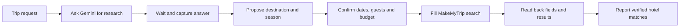

# Reading app messages and using research in another app

_2026-10-20 · implementation and verification status stated separately_

## Message reading

The owner asked for checking WhatsApp DMs, opening Instagram and other messaging apps, and summarizing their messages. This needs a read workflow before ordinary text drafting. “Summarize my WhatsApp messages” must read WhatsApp; “Summarize this: …” transforms the supplied text.

The implementation resolves the explicitly named installed app, navigates within that package, collects bounded visible app-owned text, then calls the local Writer. It keeps app, conversation and coverage outside generated prose. Inbox previews are partial previews; a verified chat is still only the messages captured on its visible screen. App controls, keyboard text, notifications and composer text are excluded from summary input. Unsupported screens must remain unread rather than be described as successfully summarized.

Device verification and measured limitations are recorded in [research/33](33-writer-live-tests.md). The availability of an installed app does not establish that its current screen exposes usable message text.

## Gemini research to MakeMyTrip prototype

**Implemented bounded prototype; live acceptance pending.** The latest APK is installed and the Gemini full-response capture and MakeMyTrip date/result-header guards are being tested. The Nepal end-to-end workflow has not yet been verified. Earlier timeouts or app openings are not evidence of completed research, correctly entered stay details or collected hotel results.

The prototype retains a Nepal hotel task per Friday chat, submits a fixed public research prompt through Gemini's UI, waits for a matching completed answer, retains the answer and a bounded destination/season proposal, then hands explicit stay inputs to MakeMyTrip. Supported proposal cities are Kathmandu, Pokhara and Lalitpur. This is a specific workflow, not a general travel planner or arbitrary Gemini task executor. See [ResearchWorkflow](../android/app/src/main/java/dev/layatest/agent/ResearchWorkflow.kt), [GeminiResponse](../android/app/src/main/java/dev/layatest/agent/GeminiResponse.kt) and [HotelSearch](../android/app/src/main/java/dev/layatest/agent/HotelSearch.kt).

Google documents asking questions and receiving responses in its Android Gemini app, and Android accessibility can inspect exposed window content and act on UI nodes. Actual response accessibility still depends on the installed app and screen. [Gemini mobile capabilities](https://support.google.com/gemini/answer/14579631), [Android window and node access](https://developer.android.com/reference/android/accessibilityservice/AccessibilityService).

Laya chooses UI actions while the bounded workflow retains task data and progress between apps; Writer alone is not a multi-step planner. A request for “a good season in Nepal” does not supply a city, exact check-in/check-out dates, guests or budget. Research proposals do not silently become confirmed stay inputs. Required dates and occupancy must be supplied; an optional budget is not proof of an applied price filter. Current availability and prices must come from the booking app. Hotel selection, reservation and payment are outside this prototype's completion boundary.

### Prototype stages and required evidence

| Step | Implemented scope | Live completion evidence still required |
|---|---|---|
| G01 | Per-chat app-private state retains the original request, public question, answer, proposal, supplied hotel fields, missing inputs and stage. | Correct context survives app switches/restart and remains isolated from another chat. |
| G02 | Known Gemini/Google host qualification, prompt submission and a longer bounded cancellable wait replace the earlier short wait. | The submitted question matches this task; waiting ends with its completed answer or an explicit pending/error outcome. |
| G03 | Completed-response capture uses a qualified full text node or response-copy route; the retained answer is returned with the workflow result. | Full answer text reaches the originating Friday chat; an old answer, viewport fragment or structured footer alone is not accepted as the answer. Source links are retained only if actually captured, not invented. |
| G04 | Strict structured-footer parsing restricts the destination/season proposal; source prose remains untrusted. | Proposal and original answer agree; suggested dates remain unconfirmed and unknown inputs remain unknown. |
| G05 | Missing stay inputs and supported follow-up corrections are retained for continuation. | Explicit check-in, checkout, adults, rooms and children are internally consistent; zero children differs from unknown. |
| G06 | Hotel-form navigation, destination/date entry and pre-search field readback are guarded; mismatched occupancy can require the owner to complete the guest picker. | Actual form matches supplied values, including date year; previous app defaults cannot bypass the guards. See the earlier [hotel failures](32-hotel-device-walkthrough.md). |
| G07 | Search and bounded result extraction require matching form/results context; budget filtering is not marked verified. | Result header matches destination, dates and guest context, and actual hotel cards supply the reported fields. No verified cards means the search remains pending. |

The table describes code paths and their acceptance criteria. It is not a record that every stage passed on the device. The more general Kotlin and Room coordinator is [researched separately](35-task-coordinator-research.md); its development is deferred until the current Nepal test is complete.

Gemini output and app messages are source data. Their content must not acquire permission to change the task or perform actions. A claim in a research answer is not proof of a live hotel result.

### Acceptance cases

1. Complete specified trip: Gemini answer → approved exact stay → matching MakeMyTrip results.
2. Season-only request: research succeeds; missing dates/guests are requested before search.
3. Ambiguous destination or conflicting seasons: present the alternatives and retain uncertainty.
4. Gemini login, rate limit, network failure or incomplete streaming: report the blocked research stage without fabricating a plan.
5. App hides response text: report unreadable content; preserve the research question for manual continuation.
6. Research answer contains an instruction to send, pay or change apps: treat it as data; do not act on it.
7. MakeMyTrip changes a date, locality or occupancy: fail verification and correct or ask before claiming results.
8. User changes the month/budget mid-flow: invalidate dependent fields/results and rerun only the affected stages.
9. Stop/resume or process restart: show completed and pending steps; never repeat a consequential action silently.

The current work is to finish and verify this bounded Nepal workflow. General coordinator development follows that test. No completed Nepal hotel search, reservation or payment is claimed here.
