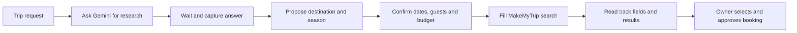

# Reading app messages and using research in another app

_2026-10-20 · implementation and verification status stated separately_

## Message reading

The owner asked for checking WhatsApp DMs, opening Instagram and other messaging apps, and summarizing their messages. This needs a read workflow before ordinary text drafting. “Summarize my WhatsApp messages” must read WhatsApp; “Summarize this: …” transforms the supplied text.

The implementation resolves the explicitly named installed app, navigates within that package, collects bounded visible app-owned text, then calls the local Writer. It keeps app, conversation and coverage outside generated prose. Inbox previews are partial previews; a verified chat is still only the messages captured on its visible screen. App controls, keyboard text, notifications and composer text are excluded from summary input. Unsupported screens must remain unread rather than be described as successfully summarized.

Device verification and measured limitations are recorded in [research/33](33-writer-live-tests.md). The availability of an installed app does not establish that its current screen exposes usable message text.

## Gemini research → MakeMyTrip: feasible, not implemented

Google documents asking questions and receiving responses in its Android Gemini app. Android accessibility services can inspect exposed window content and act on UI nodes. Together, these support a possible Friday adapter; they do not establish that the installed Gemini version exposes its entire generated answer to Friday. That must be checked on the device. [Gemini mobile capabilities](https://support.google.com/gemini/answer/14579631), [Android window and node access](https://developer.android.com/reference/android/accessibilityservice/AccessibilityService).

Laya chooses UI actions. Friday must retain the task's data and progress between apps; the current Writer alone is not a multi-step planner. A request for “a good season in Nepal” does not supply a city, exact check-in/check-out dates, guests or budget. Research should propose a travel window, then obtain the required choices before hotel search. Current availability and prices come from the booking app.

### Build steps

| Step | Work | Completion evidence |
|---|---|---|
| G01 | Represent research question, destination, proposed season, exact stay dates, guests, rooms, budget and missing fields in one retained task. | The same approved values survive every app switch and a stopped/resumed run. |
| G02 | Open Gemini, enter the exact research question and wait for a completed response. | Fresh answer differs from the previous conversation; generation ends or a bounded timeout is returned. |
| G03 | Capture answer text, visible source links, app identity and capture time. | Actual app-owned response text is captured; partial answers remain labelled partial. |
| G04 | Convert research into a small proposed trip, with unknown fields left unknown. | User can inspect and amend destination/season; model text cannot silently select dates or authorize actions. |
| G05 | Ask for remaining stay details and approval of the proposed search. | Check-in, checkout, guests and rooms are explicit and internally consistent. |
| G06 | Pass the retained fields to MakeMyTrip and verify them. | Locality, dates and occupancy match on the actual results screen, addressing the earlier [hotel failures](32-hotel-device-walkthrough.md). |
| G07 | Read a bounded set of current hotel results and retain progress. | Names, prices, currency, stay length and availability come from actual results; launching the app is not success. |
| G08 | Let the owner choose a hotel and approve consequential actions. | No duplicate search/booking after retry; final purchase uses the existing confirmation policy. |

Gemini output and app messages are source data. Their content must not acquire permission to change the task or perform actions. A claim in a research answer is not proof of a live hotel result.

### Acceptance cases

1. Complete specified trip: Gemini answer → approved exact stay → matching MakeMyTrip results.
2. Season-only request: research succeeds; missing dates/guests are requested before search.
3. Ambiguous destination or conflicting seasons: present the alternatives and retain uncertainty.
4. Gemini login, rate limit, network failure or incomplete streaming: report the blocked research stage without fabricating a plan.
5. App hides response text: report unreadable content; preserve the research question for manual continuation.
6. Research answer contains an instruction to send, pay or change apps: treat it as data; do not act on it.
7. MakeMyTrip changes a date, locality or occupancy: fail verification and correct or ask before claiming results.
8. User changes the month/budget mid-flow: invalidate dependent fields/results and rerun only the affected stages.
9. Stop/resume or process restart: show completed and pending steps; never repeat a consequential action silently.

This workflow is a next implementation step, not a claim that a Nepal hotel search or booking has been completed.
