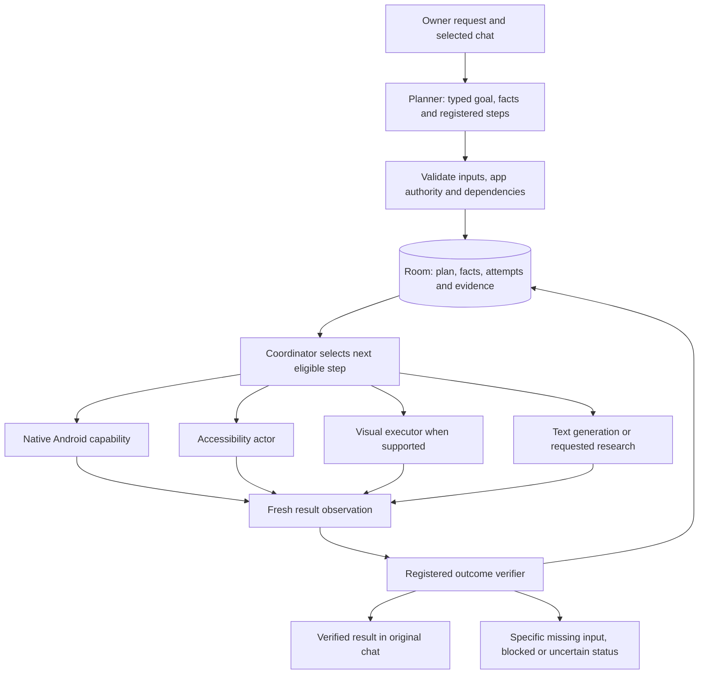

# 38 — Friday navigation, training and harness plan

_Research checked 2026-10-20. This is the implementation and experiment order, not a claim of general task completion. No new model has been trained or downloaded._

## Decision

Build the persistent execution harness and its independent evaluation first. Benchmark stronger teachers inside that harness, then train the component that the measured failures implicate. Keep native Android capabilities and the compact accessibility actor; evaluate a visual execution path for screens the actor cannot represent.

The next release gate is **verified completion on held-out tasks**, including a correct calendar block, honest bill-reading failures, and recovery without duplicate writes. Another increase in single-step benchmark accuracy is insufficient evidence for that gate.

## What the current evidence says

| Observation | Implication |
| --- | --- |
| A calendar request returned “Done” after navigating views. | Event creation and an independent saved-event check were missing. |
| A misspelled calendar request reached Clock. | App binding must be explicit and checked before execution. A capable target selector cannot repair a wrong app assignment. |
| CRED bill requests returned “Done” with no accessible app root. | Readability and observation coverage must be prerequisites. There was no bill data to summarize. |
| S11f's saved Friday-format evaluation has 59.96% joint action accuracy and 53.03% on unseen apps. | Selection and transfer need improvement. These are offline steps, not task success percentages. |
| The same saved evaluation's teacher has 61.04% joint accuracy. | More distillation from that teacher alone offers little evidence for a major capability jump. |
| Writer generation was blocked by multi-app RAM pressure on the Pixel. | A nominal parameter count does not establish a feasible phone runtime. |

Local sources: [student metrics](../training/laya-student/results/s11f.friday_test.metrics.json), [teacher metrics](../training/laya-student/results/teacher.friday_test.metrics.json), [Pixel observations](37-pixel-research-live-acceptance.md).

## Have others tried this?

Yes. These are relevant precedents, with different deployment and evaluation conditions:

| Work | Mechanism relevant to Friday | Boundary |
| --- | --- | --- |
| [Jev-Mobile](https://arxiv.org/html/2609.30186v1), September 2026 | A VLM delegates local goals and exact text to a small typed candidate selector; choices are rebuilt after each action. | Its reported 79% AndroidWorld success uses remote services. Successful-run latency/cost savings are not offline Pixel measurements. Tree-missing visual controls remain a limitation. |
| [V-Droid](https://arxiv.org/html/2503.15937v5), revised February 2026 | Rank executable actions using process-preference supervision; generate values separately and retain working memory. | Candidate-action scoring is distinct from proving a final task succeeded. The system is text-only; its headline latency was measured on two 4090s. [Detailed review](42-vdroid-paper-review.md). |
| [Qwen-Planner-Agent](https://arxiv.org/html/2609.29892v1), September 2026 | A shared action/feedback/verification contract connects tools, memory, data collection and reviewed model/harness updates. | Its 27B planner and large training system are not a single-card deployment recipe. It primarily uses structured tools; its benchmark is not an unrestricted screenshot-control evaluation. |
| [DroidCall](https://arxiv.org/abs/2412.00402) | Train compact models to invoke typed Android intents. | Intent prediction still needs permissions, execution and readback; it does not supply arbitrary app control. |
| [AutoDroid-V2](https://arxiv.org/abs/2412.18116) | App capability documentation can support small-model composition of unfamiliar tasks. | Generated automation code requires a separate execution boundary. Friday should begin with registered data-only plans rather than executing arbitrary generated scripts. |
| [AnyAppBench](https://arxiv.org/abs/2609.34139), September 2026 | Hold the goal and success condition fixed while changing the app; separate programmatic outcomes from failure diagnosis. | Its fixed instruction-only subgoal condition does not evaluate every possible persistent planner. [Detailed review](43-anyappbench-paper-review.md). |

The inference for Friday is to preserve the small actor's bounded role, improve observations and handoff, and independently test the full system. These studies do not justify assuming a planner will repair all grounding failures.

## Target runtime

Each executor receives the saved step, typed inputs, foreground binding and bounded authority. It returns structured output and observation evidence. The coordinator owns dependency order, persistence, cancellation, reconciliation and publication. Models propose actions; application code decides whether the available evidence supports completion.

A native calendar capability should handle different titles, dates and time ranges as data. A new calendar application may share Android's provider or need an adapter. A genuinely new operation needs an executor and verifier; the planner cannot invent those.

**Current implementation boundary:** research and the new device capability plans share the persisted execution loop. Calendar creation, labeled bill reading, opening/searching selected apps and standalone text drafting have registered contracts. Request interpretation for these entries remains deterministic. General generative planning, automatic composition of arbitrary requests, visual execution and migration of every legacy skill remain unfinished.

## Harness requirements

The [task harness guide](../docs/NAVIGATION_HARNESS.md) and [case manifest](../evals/navigation/cases.json) define the executable starting point.

1. **Separate three measurements:** pure parser/selector tests, synthetic coordinator behavior, and live final-state success.
2. **Use an independent oracle:** fresh provider queries for calendar events; actual visible fields/results for UI tasks; explicit source labels and amounts for bills. A model's text, a successful tap, or an executor's verified flag is insufficient.
3. **Preserve outcome distinctions:** a correct blocked response passes an honesty check while the requested task remains unsuccessful. Skipped or unavailable fixtures remain visible in coverage.
4. **Measure observation coverage:** whether the correct control was exposed, retained by filtering and available to the actor. Score action selection conditionally when that target exists.
5. **Freeze held-out splits:** vary app, task family, dates, names, UI layout and interruption point. Keep final test trajectories out of training and repair sets.
6. **Record complete accounting:** build/model/case versions, app/device versions when known, before/action/after records, retries, wait time, wall time, and manual interventions. Unknown timing components remain unknown.
7. **Use resettable test environments:** benchmark destructive or consequential operations with controlled accounts and independent resets. The owner's single foreground phone cannot host competing rollouts.
8. **Retain failures:** wrong app, wrong field/date, missing observation, false completion, duplicate write, context leak, stale action, stopped-worker continuation and unavailable environment.

### First controlled comparison

Keep the case set, initial state, permission state, budget and oracle fixed:

| | Current actor | Stronger teacher/executor |
| --- | --- | --- |
| Existing execution path | Baseline | Measures model change under the old runtime |
| Persistent harness | Measures runtime change with fixed weights | Measures combined change |

Report success and failure counts for each app and task family. Repeat seeded resettable episodes to expose variance. Compare full wall time including failures and timeouts; a separate successful-run latency statistic may also be useful. Use a failure judge for triage, with human checks, while retaining the independent success verdict.

## Training and the 4090

The [teacher shortlist](39-teacher-model-options.md) and [data/training study](40-navigation-data-and-training.md) contain artifact, licensing and memory details.

1. Benchmark an existing 4B visual teacher first, then compare an independent 8B teacher and available 2B policies. Measure actual 24 GB fit and throughput.
2. Collect a small reviewed pilot from resettable fixtures and public/synthetic data. Preserve the exact observation available to the student.
3. Teach candidate ranking only on examples the accessibility student can represent. Tag missing-candidate examples for a visual policy rather than inventing target IDs.
4. Train text/plan generation separately from action ranking. Plans must validate against the capability registry before execution.
5. Compare supervised imitation/distillation with process-preference negatives on the same data and budget. Include wrong fields, premature completion and recovery states.
6. Quantize/export only after held-out quality improves, then check parity, Pixel RAM, heat and task latency.

No training ETA is established. First measure pilot examples/second, image/context memory and teacher labeling latency on the offered machine; estimate the larger run from those observations. Large-scale online RL is a later experiment after reliable resets and rewards exist.

## Checkpoints

1. Persisted capability contracts, honest status reporting and independent oracle interfaces; build and synthetic checks.
2. Harness grader fixtures and safe live navigation runs; calendar and CRED acceptance recorded separately.
3. Teacher comparisons on frozen screenshots and resettable task environments.
4. Reviewed correction dataset and one bounded student pilot.
5. Phone export/parity and held-out task gate before deployment.

Commit and push each coherent checkpoint with its evidence and limitations. Raw phone captures, account data and training artifacts remain excluded from the public repository.
