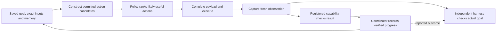

# V-Droid: what Friday should adopt and test

Checked **20 October 2026** against arXiv **2503.15937v5, revised 21 February 2026**. Read the full [PDF](https://arxiv.org/pdf/2503.15937), including §§6.4–7, and the [HTML](https://arxiv.org/html/2503.15937v5), then inspected the official artifacts and Friday's current code. This is research and an experiment plan; no device, build, model download or training run was performed.

## Recommendation

Keep Friday's persistent coordinator and independent result checks. Improve the information and training supplied to the existing candidate policy first. Benchmark an external verifier as a controlled alternative after establishing where Friday loses the required action or task context. Replacing Laya with an 8B model before measuring those failures would combine several changes and leave their causes unresolved.

This review complements the [architecture plan](38-navigation-architecture-and-harness-plan.md), [teacher comparison](39-teacher-model-options.md), [data plan](40-navigation-data-and-training.md), and [navigation harness](../docs/NAVIGATION_HARNESS.md).

## Paper findings

V-Droid ranks accessibility-derived actions with a text-only Llama-3.1-8B verifier; it has no screenshot encoder. P³ trains positive–negative progress preferences, including reached error states; excessive recovery examples cause Back loops. App names, typed content and answers still require generation. Completion is a selected action. [§§3–4](https://arxiv.org/html/2503.15937v5#S3)

On **2×4090**, reported latency is **4.3 s/step**: 0.44 verification, 0.30 completion, 3.03 memory, 0.54 transition. [§§6.1.4–6.2](https://arxiv.org/pdf/2503.15937#page=10) Cached **decision** latency is **1.034 s on one 4090**, 0.744 s on two. These are server/emulator measurements; mobile-NPU latency is estimated. [§6.5, Table 5](https://arxiv.org/pdf/2503.15937#page=13)

Memory ablation gives **59.5%** AndroidWorld success with GPT-4 summaries, **46.1%** with rule summaries, **40%** with action history. [§6.4, Table 4](https://arxiv.org/pdf/2503.15937#page=12) Final-round rank-16, 4-bit QLoRA training took **90 hours on 16×A100 40GB**. [§5.3](https://arxiv.org/html/2503.15937v5#S5.SS3) Missing actions and visual limitations remain. [§§6.6–7](https://arxiv.org/pdf/2503.15937#page=13)

Review finding: §3.1's coverage claim points to §7, but §7 provides no quantitative candidate-coverage study. [§3.1](https://arxiv.org/html/2503.15937v5#S3.SS1)

## Artifact availability and reuse

| Artifact checked | Finding and consequence |
| --- | --- |
| [Official source repository](https://github.com/V-Droid-Agent/V-Droid) | Public preview with execution and training code. The inspected root has no top-level `LICENSE`; clarify source-code reuse terms before copying it into Friday. |
| [Official model files](https://huggingface.co/V-Droid/V-Droid-8B-0323/tree/main) | Public LoRA adapter, tokenizer and `v_head.pth` exist. This is not a self-contained 8B base-model download. |
| [Model card](https://huggingface.co/V-Droid/V-Droid-8B-0323) | Labels the artifact Apache-2.0 and identifies a Llama-3.1-8B-4bit base. Check the separate [Llama 3.1 license](https://github.com/meta-llama/llama-models/blob/main/models/llama3_1/LICENSE) when assembling a runnable model. |
| [Published data directory](https://github.com/V-Droid-Agent/V-Droid/tree/main/datasets) | Contains an example P³ dataset. The inspected release does not establish availability of the full training collection. |
| [Serving instructions](https://github.com/V-Droid-Agent/V-Droid#quick-start) | Require a vLLM sampler modification. Reproduce score extraction against a pinned version before trusting an apparently successful server response. |
| [Training entrypoint](https://github.com/V-Droid-Agent/V-Droid/blob/main/train.sh) | Includes a one-GPU demo command. It supplies no measured one-4090 training duration. |

Pin code, adapter and base-model revisions separately. The available adapter's name does not establish that it reproduces every v5 setting or result. License metadata for one artifact also does not establish permission for every copied source file or base weight.

## Three different checks Friday needs

Our design conclusion: candidate ranking predicts which action to try. A capability verifier checks the observed result against saved inputs. The evaluation oracle independently judges actual task success. Sharing a model's score, a `DONE` token or Friday's own `verified` flag across these roles would hide failures.

For example, choosing **Save** is a policy decision; reading back an event with the requested dates is a capability check; an independent before/after provider query detecting exactly one matching event is the harness oracle. A correct first decision does not establish the other two results.

## Mapping to current Friday code

These are observations of the working tree on the check date. Other development is in progress; function names are more useful than fixed line numbers.

| Area | Current implementation | Small change worth evaluating |
| --- | --- | --- |
| Candidate availability | [`Candidates.kt`](../android/app/src/main/java/dev/layatest/agent/Candidates.kt) `buildCandidates` derives nodes from accessibility, merges flags and conditionally adds loose text. `shortlist` then selects a bounded target set. | Record why each expected target disappears: absent from tree, extractor exclusion, policy exclusion or shortlist loss. Improve the responsible stage before retraining a ranker. |
| Action compatibility | [`LayaEngine.kt`](../android/app/src/main/java/dev/layatest/agent/LayaEngine.kt) `step` selects operation and target in separate passes. The target question is not explicitly conditioned on the selected operation. | First test masking incompatible targets. Then compare a joint `(operation, target)` scorer on a small set of legal alternatives. Keep latency and candidate count equal where possible. |
| Context | [`Assistant.kt`](../android/app/src/main/java/dev/layatest/agent/Assistant.kt) `steps` passes an action trail and adds route hints to the subgoal. The coordinator already stores steps, facts, inputs and evidence. | Derive a bounded policy context from persisted verified facts, current subgoal and observed action effects. Preserve provenance and distinguish attempted actions from observed changes. |
| Text and values | `Assistant.steps` takes `typeText`, `pickText` or quoted spans for `INPUT_TEXT`. [`DeviceCapabilities.kt`](../android/app/src/main/java/dev/layatest/agent/DeviceCapabilities.kt) has a `text.draft` executor. | Bind a payload to the intended field and current saved step: exact owner value, generated draft, or missing input. Read it back after entry. A navigation model must not silently invent a date or reuse the previous field's text. |
| Generic completion | `Assistant.finish` records a `DONE` row and returns `Outcome.DONE`. Current `said` now returns an unverified-task response for generic navigation without a read task. | Keep this distinction. Treat `DONE` as a request to check the capability postcondition, and exclude unverified stops from positive task-success training labels. |
| Durable verification | [`TaskCoordinator.kt`](../android/app/src/main/java/dev/layatest/agent/coordinator/TaskCoordinator.kt) `deviceStep`, `verifyDeviceCheckpoint` and `publishDevice` bind saved inputs, dispatch, evidence and publication. [`coordinator/DeviceCapabilities.kt`](../android/app/src/main/java/dev/layatest/agent/coordinator/DeviceCapabilities.kt) registers result validators. | Put new navigation strategies behind these existing contracts. Preserve uncertain-write reconciliation, cancellation and origin-chat binding when changing the policy. |
| Recovery | `Assistant.steps` blocks refused targets and detects repeated identical actions; routes support replay. These mechanisms do not supply a general observed-error recovery training set. | Collect actual before/error/recovered states in resettable test apps. Label safe recovery only where its result is observed. Track oscillation and repeated Back separately from ordinary step accuracy. |
| Training objective | [`student.py`](../training/laya-student/student.py) `mix`, `distil_items` and `train` use teacher-distribution/gold targets with `soft-ce`; routing and slot replay are supported. | Add a controlled pairwise-loss experiment while retaining the same checkpoint, splits, candidate representation and routing/slot replay. Do not change all of these with the loss. |
| Runtime optimization | Laya's `forward` accepts ONNX encoder inputs (`input_ids`, masks, markers, question type). | Optimize measured encoder cost, token count, loading and screen capture separately. A causal decoder's KV-prefix cache is not a drop-in encoder feature. |

### Proposed policy memory

Reuse coordinator records; avoid creating a second planner or chat database. Supply the policy a compact view containing:

- Current capability and unsatisfied postcondition.
- Exact supplied values with their source, including resolved dates and zone.
- Relevant observed facts with evidence identifiers and capture times.
- Last attempted action and its observed effect, or explicit unknown outcome.
- Current app/screen identity, progress and bounded recovery history.

Store full evidence outside the model context. A generated summary can propose facts, but only observation-backed facts can satisfy a result check. For a Gemini-to-hotel task, this keeps a researched season recommendation separate from the owner's selected travel dates and from dates actually entered in the booking app.

## Small experiments, in order

The following are proposed Friday experiments, not reproduced paper results. Use resettable applications and fixed test data; retain the owner's existing device policy. No experiment below has been executed for this review.

| Priority | Experiment | Controlled comparison and useful output |
| --- | --- | --- |
| 0 | Establish failures and coverage | Start with the existing harness fixtures and independently captured failing tasks. Annotate roughly 100–200 decision states, including search, calendar dates, drafts, reading and app switching. Record at least one acceptable action per state and its presence at every candidate stage. Report conditional ranking accuracy only where an acceptable action survived. |
| 1 | Check memory before model size | On a small fixed set of resettable multi-step tasks, compare current action history, structured persisted state, and SLM-assisted structured state. Keep the policy fixed. Score retained facts, unsupported facts, repeated actions, goal success and memory-update latency. Include cross-app data transfer and restart. |
| 2 | Isolate loss and candidate conditioning | On about 1,000 reviewed states, compare existing categorical supervision against pairwise preference using the same student and data. Separately ablate operation-conditioned target masking and joint scoring. Split by app/task family before producing pairs; average loss per state so dense screens do not dominate. |
| 3 | Test recovery deliberately | Add reached error states from controlled wrong navigation and wrong unsent field entry. Compare recovery-pair shares of 0%, 1%, 2.5% and 5% by training pair count. Track recovered tasks, extra steps, Back oscillation and lost field values. Never assume Back undoes a saved write. |
| 4 | Benchmark the published verifier remotely | On the offered single 24GB 4090, first run a pinned inference-only pilot over the same recorded states. Measure cold/warm load, peak VRAM, candidate batches of 1/16/64, and full RPC time. Report useful ranking separately from input/payload completion. Establish feasibility before promising a training ETA. |
| 5 | Add visual help where coverage fails | For states whose correct target is absent or ambiguous in accessibility, compare the existing extractor with proposals from a documented mobile VLM teacher. Score target recall, bounds, action compatibility and added latency. Test policy ranking with and without those proposals. This isolates perception improvement from reasoning improvement. |

For preference labels, an alternative route can also be correct. Use a set of acceptable positives, reviewed hard negatives and an unknown category. Do not automatically punish every action that differs from one recorded trajectory. Include same-label controls, reordered candidates, empty/disabled fields, date pickers and near-identical navigation destinations.

For recovery data, capture the error state rather than inventing its screen. Save the successful recovery observation and original payload so clearing a field cannot be mislabeled as recovering a task that needed its previous contents.

### Acceptance gates

- **Actual goal success:** independent raw observations, with missing evidence reported as unavailable.
- **False completion and effects:** wrong dates, wrong app/recipient, duplicate writes, stale result reuse and any forbidden action counted explicitly.
- **Coverage:** acceptable target present in tree, extracted set, permitted set and shortlist; separate policy exclusions from perception failures.
- **Generalization:** held-out apps, task families and UI variants, with routing and text-slot regression scores preserved.
- **Calibration:** risk versus coverage for abstention, stratified by candidate count. Pairwise margins alone are not calibrated success probabilities.
- **Time:** request-to-verified-result wall time plus load, capture/settle, policy, generation, memory, action, wait, verification and publication durations. Include warm and cold runs, failure time and human interventions.

Use the existing [harness contracts](../docs/NAVIGATION_HARNESS.md) for provenance and independent observations. Its supported live navigation cases and synthetic fixtures must remain separately reported; a fixture passing is not evidence that a Pixel task ran successfully.

## Conclusions this evidence cannot establish

The paper does not establish an end-to-end Pixel latency, complete support for Friday's installed apps, or a verified hotel/calendar/draft handoff in this repository. Its architecture comparison does not isolate the benefit of changing only Friday's loss. Its source code and adapter availability do not establish exact reproduction of the current paper checkpoint.

Our implementation priority is therefore **coverage and result evidence → persisted policy context and payload binding → controlled student loss/recovery experiments → measured remote verifier or visual fallback**. The coordinator remains the owner of progress and completion throughout.
