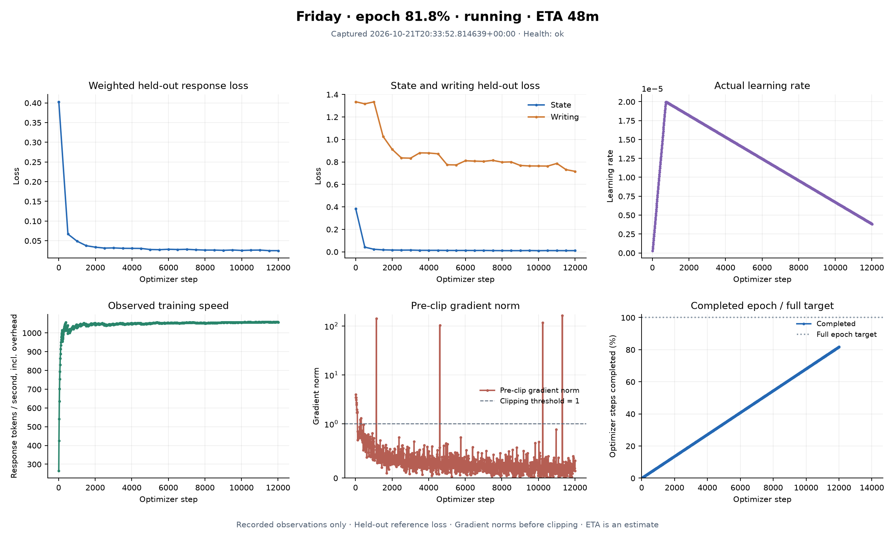

# Prepared-state training graphs

Committed snapshot captured **2026-10-21T20:33:52.814639+00:00**. The local live dashboard continues refreshing separately.

- Training status: **running**
- Optimizer updates: **12,010 / 14,678**
- Last recovery checkpoint: **12,000**
- Latest validation: **step 12,000**

| Fixed validation metric | Pinned base | Latest snapshot |
|---|---:|---:|
| Weighted loss | 0.402826 | 0.024861 |
| Context/state loss | 0.383826 | 0.010759 |
| Writing loss | 1.333817 | 0.715872 |

[Vector export](learning-curves.svg) · [Numeric graph data](metrics.json) · [How to read the graphs](../../MONITORING.md)

Lower token loss means better fit to the held-out references. Generated-answer checks and Android task completion are separate evaluations. This run uses a fixed 128-state/30-writing validation subset with 98%/2% branch loss weights.

Source corpus text, private device data, connection settings, account credit and model weights are excluded from this snapshot. Configuration SHA256: `cfd6d194c94dda3996d962deb499b0fdfe60ef351ff446f1be779bf6f9ece2db`.
